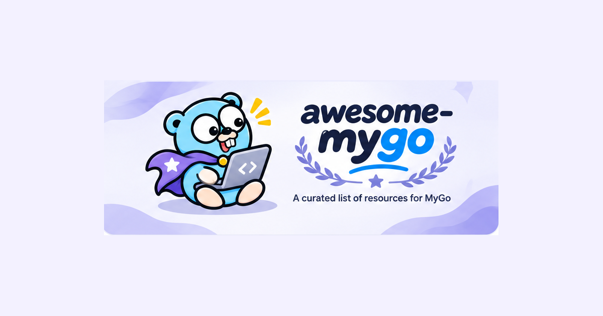

# MyGo Dock

[](https://mygodock.dev)
[](https://github.com/yldm-tech/awesome-mygo/actions/workflows/ci.yml)
[](LICENSE)

[MyGo](https://github.com/egoist/mygo) まわりのアプリ、プラグイン、コンポーネント、ドキュメントをひとつのサイトに集めました：**[mygodock.dev](https://mygodock.dev)**。MyGo は Go でデスクトップアプリを作るツールキットで、UI はネイティブ UI でも Web フロントエンドでも作れます。

[English](README.md) · [简体中文](README.zh-CN.md) · [繁體中文](README.zh-TW.md) · 日本語 · [한국어](README.ko.md)

[](https://mygodock.dev)

## サイトの内容

- **ショーケース**：MyGo で作られた 23 のデスクトップアプリ。それぞれ詳しい説明、スクリーンショット（プロジェクトが用意している場合）、UI の種類（ネイティブ UI か Web フロントエンド）、同じ作者のほかのアプリを載せています。
- **プラグイン**：公式プラグイン 11 件。Web ページ・ネイティブ UI・その両方のどれに使えるかを示し、`mygo-cli` ツールチェーンも紹介します。
- **UI コンポーネント**：MyGo アプリ向けのコンポーネントライブラリ、テーマ、アイコン。
- **状態管理**：MyGo アプリの状態管理と、MyGo 標準のバインドサービス・チャネル・型付きイベント。
- **ドキュメント**：公式ガイド 20 本、コミュニティ記事、公式リソース。
- <kbd>⌘K</kbd> / <kbd>Ctrl+K</kbd> ですべてを**検索**できます。掲載してほしいプロジェクトがあれば、投稿フォームが項目を書いてくれます。

サイトは簡体字中国語、繁体字中国語、英語、日本語、韓国語に対応しています。どのページも言語ごとに固有のアドレス（`?lang=en`）を持ち、サーバーでレンダリングされ、hreflang リンクと sitemap を備えています。

## 構成

pnpm のモノレポで、[TanStack Start](https://tanstack.com/start) が [Cloudflare Workers](https://workers.cloudflare.com) 上で配信します：

| パス | 内容 |
|---|---|
| `apps/web` | サイト本体：React 19、TanStack Start（サーバーレンダリング）、`@cloudflare/vite-plugin` 付きの Vite。`wrangler.jsonc` で `mygodock.dev` にデプロイします。 |
| `packages/catalog` | データ：アプリ、プラグイン、コンポーネント、状態管理、ガイド、5 言語の UI 文言、検索、投稿用の項目。テストで各項目が全言語でそろっていることを確認します。 |

アプリのアイコンは [yldm-tech/ai-logo](https://github.com/yldm-tech/ai-logo) の CDN から配信しています。ai-logo に収録されていない一部のアプリは、`apps/web/public/icons/` にある公式アイコンを使います。

## 開発

Node.js 24 以降と pnpm が必要です。

```sh
pnpm install
pnpm dev          # ローカルのサイト（Workers ランタイムでレンダリング）
pnpm test         # catalog のテスト
pnpm typecheck
pnpm build
pnpm preview      # 本番ビルドを Workers ランタイムで実行
```

`pnpm deploy` は Wrangler でビルドとデプロイを行います。`apps/web/wrangler.jsonc` のドメインのゾーンを持つ Cloudflare アカウントが必要です。

## プロジェクトを追加する

アプリは MyGo 公式のショーケースから取り込んでいます。アプリを掲載するには、[`egoist/mygo` の `website/src/showcase.ts`](https://github.com/egoist/mygo/blob/main/website/src/showcase.ts) にプルリクエストを送ってください。サイトの「投稿」フォームが項目を書いてくれます。ほかの種類のプロジェクトは [fksune/awesome-mygo](https://github.com/fksune/awesome-mygo) にも送れます。

このサイトに直接追加するときは `packages/catalog/src` を編集します：

- `catalog.ts`：アプリ（`APP_ROWS`、5 言語の一行説明つき）、UI コンポーネント、状態管理、プラグイン、ガイド。
- `about.ts`：アプリの詳しい説明（5 言語）。
- `strings.ts`：UI の文言。キーごとに 5 言語の配列です。
- スクリーンショットは `apps/web/public/shots/` に、幅 1200px 程度の WebP で置きます。

プルリクエストの前に `pnpm test` を実行してください。翻訳や説明が欠けている、またはリンクが https でない場合に失敗します。

## クレジット

- [MyGo](https://github.com/egoist/mygo) は [egoist](https://github.com/egoist) が作っています（MIT）。ショーケース、プラグイン、ガイドのデータはそのリポジトリとサイトに沿っています。
- [fksune/awesome-mygo](https://github.com/fksune/awesome-mygo)（CC0-1.0）はコンポーネント、記事、アプリを掲載しています。
- アプリのアイコンは [yldm-tech/ai-logo](https://github.com/yldm-tech/ai-logo)（MIT）またはアプリ自身のアイコン、スクリーンショットは egoist/mygo のショーケースと各プロジェクトの README からのものです。いずれも各アプリの作者に帰属し、名称とロゴは各社の商標で、識別のためにのみ表示しています。

## ライセンス

コードは [MIT ライセンス](LICENSE)で公開しています。
