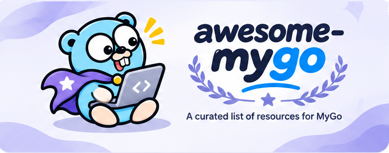

# MyGo Dock

[](https://mygodock.dev)
[](https://github.com/yldm-tech/awesome-mygo/actions/workflows/ci.yml)
[](LICENSE)

[MyGo](https://github.com/egoist/mygo) 관련 앱, 플러그인, 컴포넌트, 문서를 한 사이트에 모았습니다: **[mygodock.dev](https://mygodock.dev)**. MyGo는 Go로 데스크톱 앱을 만드는 도구로, 화면을 네이티브 UI로도 웹 프런트엔드로도 만들 수 있습니다.

[English](README.md) · [简体中文](README.zh-CN.md) · [繁體中文](README.zh-TW.md) · [日本語](README.ja.md) · 한국어

[](https://mygodock.dev)

## 사이트 내용

- **쇼케이스**: MyGo로 만든 데스크톱 앱 23개. 앱마다 자세한 설명, 스크린샷(프로젝트가 제공한 경우), 인터페이스 종류(네이티브 UI 또는 웹 프런트엔드), 같은 작성자의 다른 앱을 보여줍니다.
- **플러그인**: 공식 플러그인 11개. 웹 페이지, 네이티브 UI, 또는 둘 다 중 어디에 쓰는지 표시하며, `mygo-cli` 툴체인도 소개합니다.
- **UI 컴포넌트**: MyGo 앱을 위한 컴포넌트 라이브러리, 테마, 아이콘.
- **상태 관리**: MyGo 앱의 상태 관리 솔루션과 MyGo에 내장된 바인딩 서비스, 채널, 타입 이벤트.
- **문서**: 공식 가이드 20편, 커뮤니티 글, 공식 자료.
- <kbd>⌘K</kbd> / <kbd>Ctrl+K</kbd>로 모든 내용을 **검색**할 수 있고, 수록하고 싶은 프로젝트가 있으면 제출 양식이 항목을 대신 작성해 줍니다.

사이트는 중국어 간체, 중국어 번체, 영어, 일본어, 한국어를 지원합니다. 모든 페이지는 언어마다 고유한 주소(`?lang=en`)를 가지며, 서버에서 렌더링되고 hreflang 링크와 sitemap을 갖추고 있습니다.

## 구성

pnpm 모노레포이며, [TanStack Start](https://tanstack.com/start)가 [Cloudflare Workers](https://workers.cloudflare.com)에서 제공합니다:

| 경로 | 내용 |
|---|---|
| `apps/web` | 사이트: React 19, TanStack Start(서버 렌더링), `@cloudflare/vite-plugin`을 쓰는 Vite. `wrangler.jsonc`로 `mygodock.dev`에 배포합니다. |
| `packages/catalog` | 데이터: 앱, 플러그인, 컴포넌트, 상태 관리 솔루션, 가이드, 5개 언어의 UI 문구, 검색, 제출 항목. 테스트로 모든 항목이 모든 언어에서 채워졌는지 확인합니다. |

앱 아이콘은 [yldm-tech/ai-logo](https://github.com/yldm-tech/ai-logo)의 CDN에서 가져옵니다. ai-logo에 없는 일부 앱은 `apps/web/public/icons/`의 공식 아이콘을 씁니다.

## 개발

Node.js 24 이상과 pnpm이 필요합니다.

```sh
pnpm install
pnpm dev          # 로컬 사이트(Workers 런타임에서 렌더링)
pnpm test         # catalog 테스트
pnpm typecheck
pnpm build
pnpm preview      # 프로덕션 빌드를 Workers 런타임에서 실행
```

`pnpm deploy`는 Wrangler로 빌드하고 배포합니다. `apps/web/wrangler.jsonc`에 있는 도메인의 영역(zone)을 가진 Cloudflare 계정이 필요합니다.

## 프로젝트 추가

앱은 MyGo 공식 쇼케이스에서 가져옵니다. 앱을 수록하려면 [`egoist/mygo`의 `website/src/showcase.ts`](https://github.com/egoist/mygo/blob/main/website/src/showcase.ts)에 풀 리퀘스트를 보내세요. 컴포넌트, 플러그인, 상태 관리 솔루션, 글은 이 저장소에 [이슈를 열어](https://github.com/yldm-tech/awesome-mygo/issues/new) 주세요. 사이트의 "제출" 양식은 두 경우 모두 대신 작성해 줍니다. 앱은 showcase.ts 항목을, 그 밖에는 내용이 채워진 이슈를 만듭니다.

이 사이트에 직접 추가하려면 `packages/catalog/src`를 수정합니다:

- `catalog.ts`: 앱(`APP_ROWS`, 5개 언어의 한 줄 설명 포함), UI 컴포넌트, 상태 관리 솔루션, 플러그인, 가이드.
- `about.ts`: 앱의 자세한 설명(5개 언어).
- `strings.ts`: UI 문구. 키마다 5개 언어의 배열입니다.
- 스크린샷은 `apps/web/public/shots/`에 너비 약 1200px의 WebP로 둡니다.

풀 리퀘스트 전에 `pnpm test`를 실행하세요. 번역이나 설명이 빠졌거나 링크가 https가 아니면 실패합니다.

## 크레딧

- [MyGo](https://github.com/egoist/mygo)는 [egoist](https://github.com/egoist)가 만들었습니다(MIT). 쇼케이스, 플러그인, 가이드 데이터는 그 저장소와 사이트를 따릅니다.
- 앱 아이콘은 [yldm-tech/ai-logo](https://github.com/yldm-tech/ai-logo)(MIT) 또는 앱 자체의 아이콘이며, 스크린샷은 egoist/mygo 쇼케이스와 각 프로젝트의 README에서 가져왔습니다. 모두 각 앱의 작성자에게 속하며, 이름과 로고는 해당 상표로 식별 목적으로만 표시합니다.

## 라이선스

코드는 [MIT 라이선스](LICENSE)로 공개합니다.
