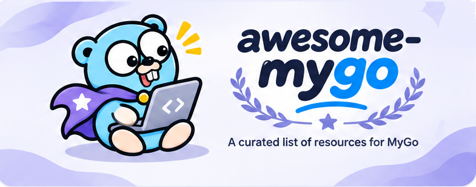

# MyGo Dock

[](https://mygodock.dev)
[](https://github.com/yldm-tech/awesome-mygo/actions/workflows/ci.yml)
[](LICENSE)

The apps, plugins, components and guides around [MyGo](https://github.com/egoist/mygo), the Go toolkit for desktop apps with native UI or a web frontend, collected on one site: **[mygodock.dev](https://mygodock.dev)**.

English · [简体中文](README.zh-CN.md) · [繁體中文](README.zh-TW.md) · [日本語](README.ja.md) · [한국어](README.ko.md)

[](https://mygodock.dev)

## What is on the site

- **Showcase**: 23 desktop apps built with MyGo. Each has its full description, a screenshot where the project has one, its interface (native UI or web frontend) and its other apps by the same author.
- **Plugins**: the 11 official plugins, marked by the kind of window they serve (web pages, native UI or both), plus the `mygo-cli` toolchain.
- **UI components**: component libraries, themes and icons made for MyGo apps.
- **State**: state management for MyGo apps, beside MyGo's own bound services, channels and typed events.
- **Learn**: the 20 official guides, a community article and the official resources.
- **Search** across everything with <kbd>⌘K</kbd> / <kbd>Ctrl+K</kbd>, and a form that writes the entry for a project you want listed.

The site speaks Simplified Chinese, Traditional Chinese, English, Japanese and Korean. Every page has its own address per language (`?lang=en`), is rendered on the server, and has hreflang links and a sitemap.

## How it is built

A pnpm monorepo, served by [TanStack Start](https://tanstack.com/start) on [Cloudflare Workers](https://workers.cloudflare.com):

| Path | What it holds |
|---|---|
| `apps/web` | The site: React 19, TanStack Start (server rendering) and Vite with `@cloudflare/vite-plugin`. `wrangler.jsonc` deploys it to `mygodock.dev`. |
| `packages/catalog` | The data: apps, plugins, components, state solutions, guides, the UI copy in five languages, search and the submission entries. Its tests check that every entry is complete in every language. |

App icons come from [yldm-tech/ai-logo](https://github.com/yldm-tech/ai-logo), served by its CDN; the few apps it does not list use their official icon from `apps/web/public/icons/`.

## Development

Requires Node.js 24 or later and pnpm.

```sh
pnpm install
pnpm dev          # local site, rendered by the Workers runtime
pnpm test         # catalog tests
pnpm typecheck
pnpm build
pnpm preview      # the production build in the Workers runtime
```

`pnpm deploy` builds and deploys with Wrangler. It needs a Cloudflare account that holds the zone of the domain in `apps/web/wrangler.jsonc`.

## Adding a project

Apps come from MyGo's own showcase. To list an app, open a pull request on [`egoist/mygo` `website/src/showcase.ts`](https://github.com/egoist/mygo/blob/main/website/src/showcase.ts). For components, plugins, state solutions and articles, [open an issue](https://github.com/yldm-tech/awesome-mygo/issues/new) here. The site's "Submit" form writes either one for you: the showcase entry, or an issue with the entry filled in.

To add something to this site directly, edit `packages/catalog/src`:

- `catalog.ts`: apps (`APP_ROWS`, with a one-line description in five languages), UI components, state solutions, plugins and guides.
- `about.ts`: an app's full description in five languages.
- `strings.ts`: the UI copy, an array of the five languages per key.
- Screenshots go in `apps/web/public/shots/`, as WebP about 1200px wide.

Run `pnpm test` before opening a pull request: it fails on a missing translation, a missing description or a non-https link.

## Credits

- [MyGo](https://github.com/egoist/mygo) is made by [egoist](https://github.com/egoist) (MIT). The showcase, plugin and guide data follows its repository and site.
- App icons are from [yldm-tech/ai-logo](https://github.com/yldm-tech/ai-logo) (MIT) or the apps' own icons. Screenshots come from egoist/mygo's showcase and the projects' READMEs. Both belong to the apps' authors; names and logos are their trademarks and are shown to identify them.

## License

The code is released under the [MIT License](LICENSE).
