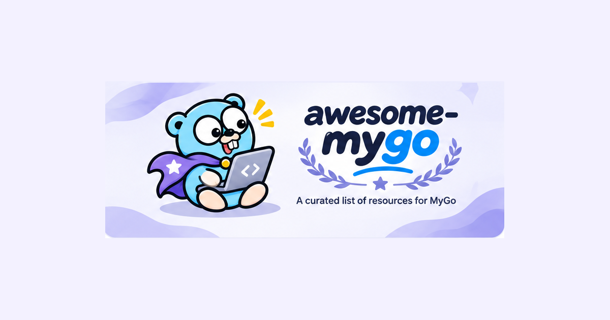

# MyGo Dock

[](https://mygodock.dev)
[](https://github.com/yldm-tech/awesome-mygo/actions/workflows/ci.yml)
[](LICENSE)

把围绕 [MyGo](https://github.com/egoist/mygo) 的应用、插件、组件和文档收集在一个站点里：**[mygodock.dev](https://mygodock.dev)**。MyGo 是用 Go 构建桌面应用的工具包，界面可以是原生 UI，也可以是 Web 前端。

[English](README.md) · 简体中文 · [繁體中文](README.zh-TW.md) · [日本語](README.ja.md) · [한국어](README.ko.md)

[](https://mygodock.dev)

## 站点内容

- **作品**：23 款用 MyGo 做的桌面应用，每款都有完整介绍、截图（项目提供时）、界面类型（原生 UI 或 Web 前端），以及同一作者的其他作品。
- **插件**：11 个官方插件，标明适用于网页、原生 UI 还是两者，另有 `mygo-cli` 工具链。
- **UI 组件**：为 MyGo 应用做的组件库、主题与图标。
- **状态管理**：MyGo 应用的状态方案，以及 MyGo 自带的绑定服务、通道和类型化事件。
- **文档**：20 篇官方指南、一篇社区文章和官方资源。
- 用 <kbd>⌘K</kbd> / <kbd>Ctrl+K</kbd> **搜索**全部内容；想收录某个项目时，提交表单会替你写好条目。

站点支持简体中文、繁体中文、英语、日语和韩语。每个页面在每种语言下都有独立地址（`?lang=en`），由服务端渲染，并带有 hreflang 链接和 sitemap。

## 技术实现

pnpm monorepo，由 [TanStack Start](https://tanstack.com/start) 运行在 [Cloudflare Workers](https://workers.cloudflare.com) 上：

| 路径 | 内容 |
|---|---|
| `apps/web` | 站点：React 19、TanStack Start（服务端渲染），以及带 `@cloudflare/vite-plugin` 的 Vite。`wrangler.jsonc` 把它部署到 `mygodock.dev`。 |
| `packages/catalog` | 数据：应用、插件、组件、状态方案、指南，五种语言的界面文案，搜索与提交条目。测试会检查每个条目在每种语言下都已填写完整。 |

应用图标来自 [yldm-tech/ai-logo](https://github.com/yldm-tech/ai-logo)，由它的 CDN 提供；它未收录的少数应用使用 `apps/web/public/icons/` 里的官方图标。

## 本地开发

需要 Node.js 24 或更高版本，以及 pnpm。

```sh
pnpm install
pnpm dev          # 本地站点，由 Workers 运行时渲染
pnpm test         # catalog 测试
pnpm typecheck
pnpm build
pnpm preview      # 在 Workers 运行时中运行生产构建
```

`pnpm deploy` 会用 Wrangler 构建并部署，需要一个包含 `apps/web/wrangler.jsonc` 中域名 zone 的 Cloudflare 账户。

## 收录项目

应用来自 MyGo 官方的作品展示。要收录应用，请向 [`egoist/mygo` 的 `website/src/showcase.ts`](https://github.com/egoist/mygo/blob/main/website/src/showcase.ts) 提交 PR；站点上的「提交」表单会替你写好条目。其他类型的项目也可以提交到 [fksune/awesome-mygo](https://github.com/fksune/awesome-mygo)。

要直接为本站添加内容，编辑 `packages/catalog/src`：

- `catalog.ts`：应用（`APP_ROWS`，附五种语言的一句话描述）、UI 组件、状态方案、插件和指南。
- `about.ts`：应用的完整介绍，五种语言。
- `strings.ts`：界面文案，每个键是一个包含五种语言的数组。
- 截图放在 `apps/web/public/shots/`，WebP 格式，宽约 1200px。

提交 PR 前请运行 `pnpm test`：缺少翻译、缺少描述或链接不是 https 时，测试会失败。

## 致谢

- [MyGo](https://github.com/egoist/mygo) 由 [egoist](https://github.com/egoist) 创建（MIT）。作品、插件和指南的数据以它的仓库和官网为准。
- [fksune/awesome-mygo](https://github.com/fksune/awesome-mygo)（CC0-1.0）收录组件、文章和应用。
- 应用图标来自 [yldm-tech/ai-logo](https://github.com/yldm-tech/ai-logo)（MIT）或应用自己的图标；截图来自 egoist/mygo 的作品展示和各项目的 README。两者都归各应用作者所有，名称和标志是其商标，仅用于识别。

## 许可证

代码以 [MIT 许可证](LICENSE) 发布。
